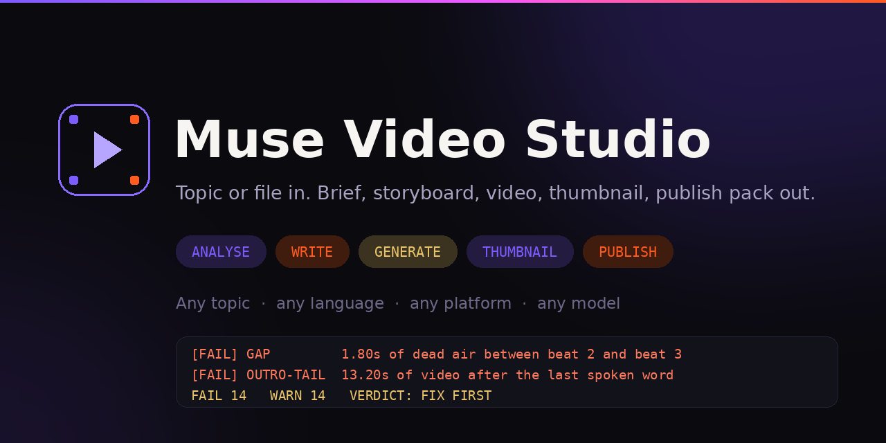
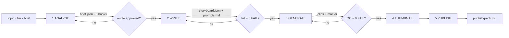

# Video Studio



**A production skill for AI agents: give it a topic or a file, get a brief, a storyboard, generation prompts, a video, a platform-correct thumbnail, and the copy to publish it.**

No channel hardcoded. No niche assumed. Kids' education is one preset among many.



## The problem this solves

Most video skills stop at prompt engineering. That is the easy half.

The failures that actually cost views are **structural**:

- a hook that opens on a logo instead of a claim
- 1.8 seconds of dead air at 00:26 that reads as buffering
- a quiz asked over a talking shot, so nobody knows they should answer
- a 6-second static outro that tells the viewer to swipe away
- a vertical video uploaded with a horizontal thumbnail, cropped to nonsense

This skill turns each of those into a **machine check** — once before you spend credits, and again on the rendered file.

## See it work

```bash
$ python3 skills/video-studio/scripts/lint_storyboard.py tests/fixtures/broken-storyboard.json
```

```
  [FAIL] GAP            1.80s of dead air between beat 2 (00:07.40) and beat 3 (00:09.20)
  [FAIL] DUP            beat 5 repeats beat 4 (60% overlap of content words)
  [FAIL] HOOK-INTRO     hook opens with housekeeping: "Hi kids! Welcome back to Fun Education TV!"
  [FAIL] QUIZ-LAYOUT    quiz layout is 'side-profile-static'
  [FAIL] QUIZ-TEXT      0 on-screen options
  [FAIL] OUTRO-TAIL     13.20s of video after the last spoken word (cap 2.0s)
  [FAIL] FACT           beat 4 makes a factual claim with no claim_source
  FAIL 14   WARN 14   VERDICT: FIX FIRST
```

Every one of those is a real defect from a real shipped video. Fix the plan, re-run, and the same board passes clean:

```bash
$ python3 skills/video-studio/scripts/lint_storyboard.py examples/kids-education/storyboard.json
  FAIL 0   WARN 0   VERDICT: PUBLISH-READY
```

Then the render gate catches what only pixels can show:

```
[FAIL] FREEZE-TAIL    picture is static for the last 6.0 s (from 00:30.00 to 00:36.00)
[FAIL] SILENCE        2.00 s of silence at 00:20.00-00:22.00
[FAIL] SHOT-CADENCE   one shot holds 30.0 s (00:00.00-00:30.00)
```

## Quick start

**60 seconds, no API key, no ffmpeg:**

```bash
git clone https://github.com/mraaisa-afk/muse-video-studio.git
cd muse-video-studio
python3 tests/run_tests.py                                    # 14/14 should pass
python3 skills/video-studio/scripts/lint_storyboard.py \
        examples/bengali-tiktok/storyboard.json               # a real Bengali example
```

**Actually use it — in Muse or any Agent-Skills assistant:**

```
Use the video-studio skill.
Topic: "why cold showers wake you up faster than coffee"
Platform: Instagram Reels · Language: English · 30 seconds
```

The first reply must be a **150-word brief and five ranked hooks** — not a video prompt. That separation is what stops the output from being generic.

Then work the gates:

| Stage | You get | Gate |
|---|---|---|
| 1 Analyse | `brief.json`, hooks, risks, assumptions | you approve the angle |
| 2 Write | `storyboard.json`, `prompts.md` | `lint_storyboard.py` → 0 FAIL |
| 3 Generate | clips + `master.mp4` | `qc_video.py` → 0 FAIL |
| 4 Thumbnail | master + 2 alternates, crop-safe | readable at 120 px |
| 5 Publish | `publish-pack.md` | every platform field complete |

## What it covers

### Platforms

| | Video | Thumbnail | Copy |
|---|---|---|---|
| YouTube Shorts | 9:16, 15–60 s sweet | 2160×3840 (16:9 also accepted) | title-first, 3 hashtags |
| YouTube long-form | 16:9, chapters | 3840×2160, ≤2 MB mobile | search-intent description |
| Facebook Reels / feed | 9:16 / 1.91:1 | 1080×1920 / 1200×630 | written to be shared |
| Instagram Reels / feed | 9:16 / 4:5 | 1080×1920 (3:4 grid crop) | first line carries it |
| TikTok | 9:16, 12–40 s sweet | 1080×1920 (1:1 grid crop) | 3–5 hashtags, no links |
| LinkedIn | 16:9 | 1200×627 | claim, evidence, caveat |
| X | 16:9 | 1280×720 | one idea |

### Models — with the limits stated honestly

| Tool | Clip limit | Audio in generation | Continuity |
|---|---|---|---|
| Muse built-in | ~10 s, not settable | synthetic SFX only, **no audio input** | snapshot ID, last frame |
| Veo 3.1 | 4 / 6 / 8 s | **native dialogue + SFX** | extension, +7 s per call |
| Sora | 5–20 s | silent | stitch |
| Kling / Seedance | 5–10 s | usually silent | strongest image-to-video identity lock |

The skill tells you which to pick for dialogue, for identity, and for length — and refuses to promise face-lock where the model does not deliver it.

### Languages

Pacing is calibrated per language. The tokenizer keeps Indic scripts intact, so Bengali and Hindi are not shredded into fragments by a naive regex.

```
en · bn · hi · ur · es · fr · pt · ar · id
```

```
$ python3 skills/video-studio/scripts/lint_storyboard.py examples/bengali-tiktok/storyboard.json
  [WARN] SHOT-LENGTH   beat 4 holds one shot 3.3s
  FAIL 0   WARN 1   VERDICT: PUBLISH-READY
```

## Repository layout

```
muse-video-studio/
├── skills/video-studio/          the skill package (Agent Skills format)
│   ├── SKILL.md                  pipeline, gates, 12 operating rules
│   ├── references/               9 files, loaded on demand
│   ├── presets/                  kids-education · product-ad
│   ├── assets/                   brief, storyboard and publish-pack templates
│   └── scripts/                  lint_storyboard.py · qc_video.py
├── examples/                     3 complete worked examples, each passing the gate
├── docs/                         quickstart · how the gates work · FAQ
├── tests/                        dependency-free suite + a deliberately broken fixture
└── scripts/validate_skill.py     format self-check
```

## The rules the lint enforces

| Group | Rules |
|---|---|
| Platform fit | duration window, aspect, title length, hashtag count |
| Hook | starts at 0, ≤3 s, no "welcome back", no logo card, has a question or on-screen text |
| Timeline | overlapping beats, dead air > 0.45 s |
| Repetition | consecutive lines with ≥60% shared content words, agreement lines |
| Pace | words per second per line, calibrated per language |
| Structure | shot-length caps, beat count, static end cards |
| Quiz (optional) | card layout, labelled options, countdown, 3–6 s on screen |
| Outro | tail after the last word, loop seam, CTA present |
| Integrity | every factual claim sourced when the format requires it |
| Safety | kids' vocabulary list vs general policy list |
| Thumbnail | text present, 2–4 words, not just a repeat of the title |
| Publish | title, keyword position, hashtags, pinned comment |

Add a platform by adding one row to the `PLATFORMS` dict. Nothing else changes.

## Install

**Muse app** — consumer Muse has no skill upload as of October 2026. Copy `SKILL.md` into a fresh chat and say *"use this whenever I ask for a video, remember it for our future conversations."* Keep that chat pinned.

**Muse Code** — reads standard `SKILL.md` files:

```bash
cp -r skills/video-studio ~/.agents/skills/
muse skills validate ./skills/video-studio
muse skills install ./skills/video-studio --scope user
```

**Any other agent** — plain Agent Skills format (Claude Code, Cursor, Codex, Gemini CLI). The scripts run standalone on Python 3.10+.

Full detail: [`docs/quickstart.md`](docs/quickstart.md) · [`skills/video-studio/INSTALL.md`](skills/video-studio/INSTALL.md)

## Honest limits

- `lint_storyboard.py` measures the **plan**. A clean lint means the structure is sound, not that the video is good.
- `qc_video.py` measures duration, freeze, silence, cuts and loudness. It **cannot** hear the voice, judge lip-sync, balance the music, or know whether the joke lands.
- Face-lock is weak on built-in generators. The skill tells you to regenerate a drifting clip, not to ship it.
- This is a process skill. It raises your floor and stops the repeats. Taste is still yours.

Every QC report the skill produces ends with an explicit **not-verified list**, so you always know what still needs human eyes and ears.

## Contributing

Presets, platform rows, language calibrations and case cards are all welcome — see [CONTRIBUTING.md](CONTRIBUTING.md). The bar is simple: *bring evidence, not adjectives.*

## License

MIT — use it commercially, fork it, ship it inside your own product.

---

**If this saved you a bad upload, a star helps someone else find it.**
